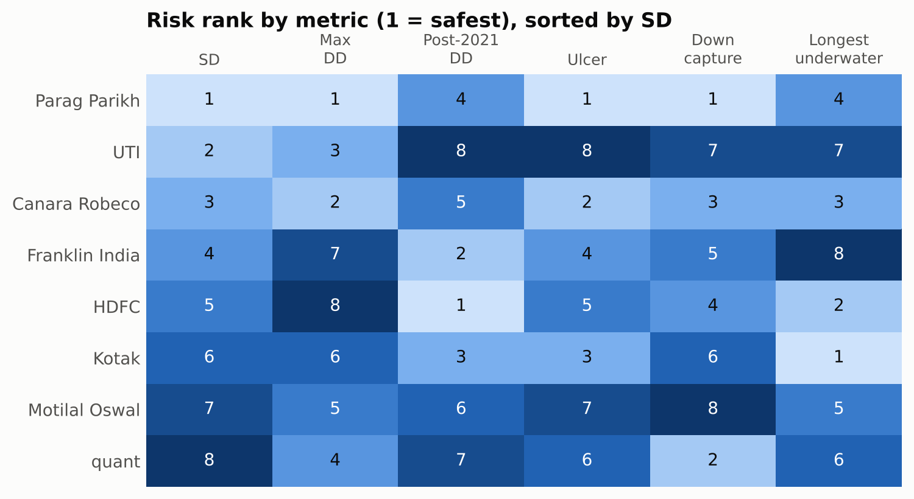
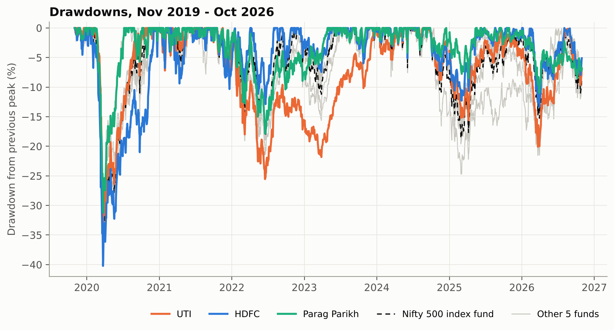
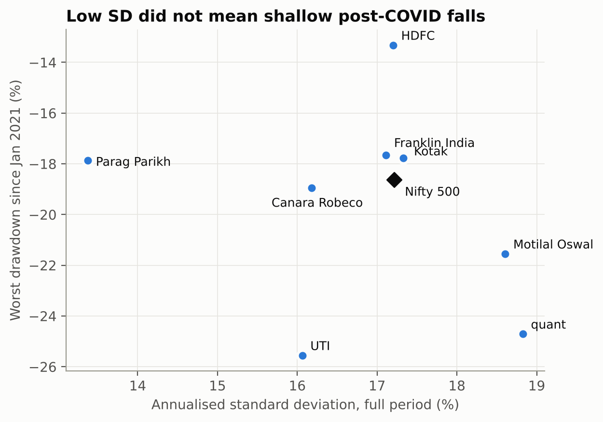
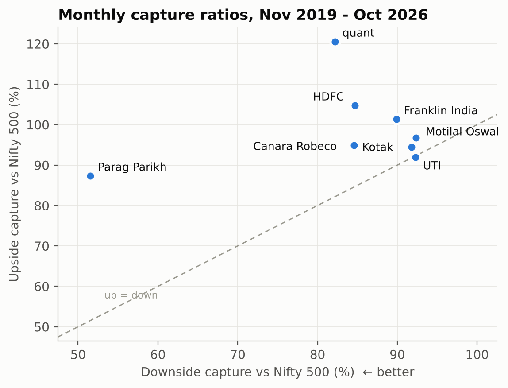
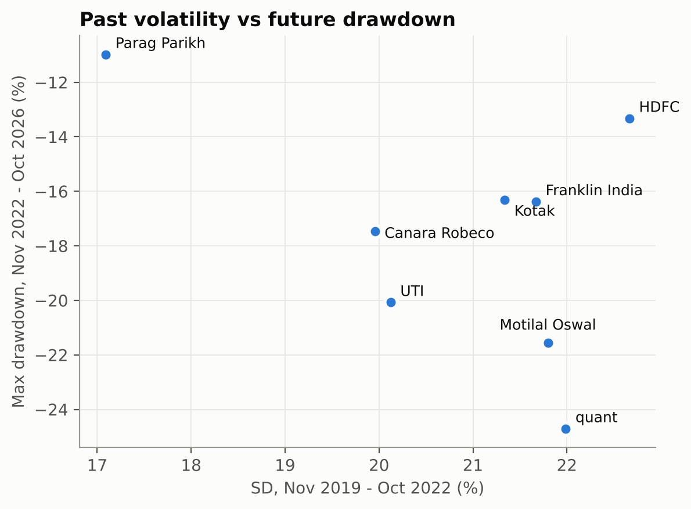

# Does lower volatility really mean a safer mutual fund?

A comparison of 8 Indian Flexi Cap funds (Direct, Growth) over 1 Nov 2019 – 30 Oct 2026, benchmarked against a Nifty 500 index fund.

## The answer

**Only partly. Low volatility identified the safest fund in this sample, but it did not reliably rank the other seven.**

- **Where it worked:** Parag Parikh had the lowest standard deviation (SD) and also ranked first on full-period max drawdown, Ulcer Index and downside capture.
- **Where it failed:** UTI had the second-lowest SD (16.1%) but the deepest drawdown since 2021 (−25.6%) and the worst Ulcer Index. Its falls were gradual enough to keep SD low, and it had still not regained its September 2024 high when the window closed.
- **Why the metrics disagree:** each one measures something different. SD ignores the order of returns, max drawdown can come down to one event, downside capture is relative to a benchmark, and concentration is about what could go wrong next.

With only 8 funds, these results are descriptive and not statistical proof (see [Limitations](#limitations)).

## Scorecard

Funds are sorted from lowest to highest SD. Green marks the safest fund in each risk column and red the riskiest. Top 10 is a snapshot of recent holdings; the other columns cover the full period unless the heading says otherwise.

| Fund | SD | Max DD | Post-2021 DD | Ulcer | Down capture | Up capture | Top 10 weight | CAGR |
|---|---:|---:|---:|---:|---:|---:|---:|---:|
| Parag Parikh | 🟢 13.4% | 🟢 −31.2% | −17.9% | 🟢 5.6 | 🟢 51.6% | 87.4% | 49.7% | 18.4% |
| UTI | 16.1% | −33.9% | 🔴 −25.6% | 🔴 10.0 | 92.3% | 92.0% | 44.3% | 12.1% |
| Canara Robeco | 16.2% | −33.2% | −19.0% | 7.0 | 84.6% | 95.0% | 🟢 36.8% | 14.4% |
| Franklin India | 17.1% | −37.3% | −17.7% | 7.8 | 89.9% | 101.4% | 39.9% | 15.6% |
| HDFC | 17.2% | 🔴 −40.2% | 🟢 −13.3% | 8.0 | 84.7% | 104.8% | 43.7% | 17.6% |
| Kotak | 17.3% | −37.3% | −17.8% | 7.5 | 91.8% | 94.4% | 42.2% | 12.9% |
| Motilal Oswal | 18.6% | −37.1% | −21.5% | 9.3 | 🔴 92.3% | 96.8% | 47.8% | 13.1% |
| quant | 🔴 18.8% | −35.3% | −24.7% | 8.6 | 82.2% | 120.6% | 🔴 52.4% | 23.4% |
| *Nifty 500 index fund* | *17.2%* | *−37.3%* | *−18.6%* | *7.8* | *100%* | *100%* | – | *13.0%* |

## Approach

### 1. Choose comparable funds

The eight funds are Parag Parikh, HDFC, Kotak, quant, Franklin India, Canara Robeco, UTI and Motilal Oswal. All come from one SEBI category, Flexi Cap, so managers work under the same broad mandate. Using only Direct Growth plans means that distribution costs and dividend payouts don't distort NAV comparisons.

The benchmark is the Motilal Oswal Nifty 500 Index Fund (Direct). It is an investable proxy for the Nifty 500 TRI, and its returns are after costs and tracking difference.

### 2. Build a common dataset

- **Source:** daily AMFI NAVs from [captn3m0/historical-mf-data](https://github.com/captn3m0/historical-mf-data).
- **Alignment:** only dates on which all nine schemes have a NAV are kept. This leaves 1,723 observations.
- **Window:** about 7 years, covering the COVID crash, the 2022 and 2023 corrections, and the 2024–25 sell-off.

### 3. Measure risk in several ways

Each metric answers a different question, so each has a different blind spot.

| Metric | How it is calculated | Question it answers | Blind spot |
|---|---|---|---|
| **Standard deviation** | Daily returns × √252 | How bumpy is the ride? | Ignores the order of returns, and penalises upside as much as downside |
| **Max drawdown** | Worst peak-to-trough NAV fall, with recovery dates | What was the worst loss? | Reflects a single event |
| **Post-2021 drawdown** | Max drawdown measured from Jan 2021 | How bad was it outside COVID? | Excludes the largest crash |
| **Ulcer Index** | √(mean of squared drawdowns) | How deep and long were the falls? | Less intuitive, and depends on the path taken |
| **Longest underwater spell** | Most calendar days between new highs | How long did recovery take? | Spells still open at the end are cut short |
| **Downside capture** | Geometric mean fund return ÷ geometric mean benchmark return, in the benchmark's down months | How much of the market's falls did it take? | Relative only, and based on 30 down months |
| **Portfolio concentration** | Top 1/5/10/20 weights, HHI, effective names, financials share | How much rests on a few holdings? | A recent snapshot, not a 7-year history |

`analysis.py` also calculates supporting metrics: upside capture, beta, downside deviation, worst day and month, and 5% daily CVaR. Sharpe-like and Sortino-like ratios use a flat 6% risk-free rate.

### 4. Measure concentration from holdings

Holdings come from the latest disclosures available (Aug–Oct 2026) on Groww, RightAdvise and Sharpely, and are hard-coded in `holdings.py`. Only equity lines are used, as a percentage of net assets. Sectors are reduced to financials versus everything else because the sources classify them differently.

### 5. Test whether the metrics agree

The analysis tests agreement in four ways:

1. **Rank comparison:** rank the funds from 1 (safest) to 8 on each metric, then calculate Spearman correlations between the rankings.
2. **Stress episodes:** measure each fund's return during every benchmark fall of more than 10%, using the benchmark's peak and trough dates.
3. **Rolling volatility:** rank the funds on 1-year rolling SD to see whether the SD ranking itself is stable.
4. **Out-of-sample test:** split the window at 1 Nov 2022 and check whether risk in the first half predicts risk in the second.

## Findings

† marks a robustness check calculated separately from the saved outputs in this repo (`data/nav.csv`, `data/metrics.csv` and `data/concentration.csv`). The scripts don't write these figures to their output files.

### 1. SD and the other risk metrics rank funds differently



| Rank correlation with SD | Max DD | Ulcer | Down capture | Post-2021 DD | Longest underwater |
|---|---:|---:|---:|---:|---:|
| Spearman ρ | +0.52 | +0.40 | +0.24 | +0.05 | −0.10 |

SD has its strongest link with full-period max drawdown, and almost none with post-2021 drawdown or time underwater. Two funds stand out:

- **HDFC:** ranks from 1st to 8th depending on the metric, the widest range in the group.
- **Canara Robeco:** ranks 2nd to 5th, and has the second-best average rank after Parag Parikh.

Replacing SD with a downside-only measure would not change much. Across these funds, SD is almost interchangeable with downside deviation (ρ = 0.95) and 5% CVaR (|ρ| = 0.98).†

### 2. Low volatility can hide a slow, persistent loss



UTI's SD was below the benchmark's, yet its drawdown curve stays well below the others through 2022–23. It spent 31.6% of trading days more than 10% below a previous peak, compared with 12.5% for HDFC and 7.3% for Parag Parikh.† Its CAGR, 12.1%, was also the lowest of the group.

SD can miss this because it treats returns as if their order doesn't matter. A run of small losses barely registers in SD, but it compounds into a deep drawdown.



This chart compares full-period SD with post-2021 drawdown, so the periods differ. Using post-2021 SD for both tightens the relationship only slightly, to ρ = +0.33 on a safety-rank basis:†

- **UTI still contradicts SD:** it has the third-lowest SD and the deepest drawdown.
- **HDFC no longer does:** its SD rank moves from 5th to 2nd, so much of its apparent mismatch came from COVID being in one measure and not the other.

### 3. Max drawdown can reflect one event

Every fund's full-period max drawdown bottomed on 23 or 24 March 2020. That number therefore mostly shows how funds behaved during COVID.

Performance in one fall didn't carry over to the next:

| Fund | Jan–Mar 2020 | Oct 2021–Jun 2022 | Dec 2022–Mar 2023 | Sep 2024–Feb 2025 |
|---|---:|---:|---:|---:|
| Parag Parikh | **−29.2%** | −17.5% | **−1.4%** | **−6.8%** |
| UTI | −31.5% | *−25.0%* | −11.1% | −14.9% |
| Canara Robeco | −30.7% | −18.4% | −9.2% | −17.5% |
| Franklin India | −36.9% | −16.9% | −9.6% | −16.2% |
| HDFC | *−39.9%* | **−11.3%** | −7.4% | −12.2% |
| Kotak | −36.9% | −16.8% | −8.0% | −16.3% |
| Motilal Oswal | −36.0% | −21.2% | *−12.3%* | −16.4% |
| quant | −34.1% | −17.3% | −12.3% | *−24.3%* |
| *Nifty 500 index fund* | *−37.3%* | *−18.0%* | *−11.2%* | *−18.6%* |

**Bold** is the best fund in each episode and *italic* the worst. HDFC went from worst in the first episode to best in the second.

### 4. Downside capture is useful, but it was not stable



Every fund captured less of the market's falls than the benchmark, and most also lagged or roughly matched it on the way up. Only Parag Parikh sits far from the group.

quant has the highest SD but the second-best downside capture (82.2%), which looks like a clear contradiction of SD. Splitting the window shows why that figure needs care:

| Fund | Down capture, Nov 2019–Oct 2022 | Down capture, Nov 2022–Oct 2026 |
|---|---:|---:|
| quant | 59.7% | 104.4% |
| HDFC | 101.0% | 68.4% |
| Parag Parikh | 65.7% | 37.5% |

The full-period number averages two very different periods for quant and HDFC. Parag Parikh was the only one of these three to stay well below the benchmark in both.

### 5. Concentration adds information the return-based metrics can't

| Fund | Stocks | Largest holding | Top 5 | Top 10 | Top 20 | HHI (top 20) | Financials in top 20 |
|---|---:|---:|---:|---:|---:|---:|---:|
| Parag Parikh | n/a | 7.8% | 29.5% | 49.7% | 68.9% | 304 | 25.2% |
| UTI | 53 | 6.6% | 26.5% | 44.3% | 67.7% | 264 | 19.4% |
| Canara Robeco | 83 | 6.6% | 23.4% | 36.8% | 53.3% | 186 | 24.2% |
| Franklin India | 57 | 6.5% | 24.2% | 39.9% | 61.0% | 218 | 23.5% |
| HDFC | 79 | 8.8% | 28.3% | 43.7% | 63.2% | 266 | 31.5% |
| Kotak | 55 | 5.5% | 24.6% | 42.2% | 65.5% | 240 | 20.4% |
| Motilal Oswal | 31 | 8.2% | 29.2% | 47.8% | 75.7% | 329 | 16.3% |
| quant | 27 | 9.6% | 37.8% | 52.4% | 67.8% | 363 | 8.6% |

- **Concentrated doesn't always mean volatile:** Parag Parikh has the lowest SD but the second-highest top-10 weight. Across the group, HHI's correlation with SD is only +0.45.†
- **Stock-level measures can understate exposure:** quant holds 22.4% in four Adani group companies, a shared exposure that its HHI doesn't capture because each company counts separately.
- **A long stock list can still hide a concentrated bet:** HDFC holds 79 stocks, but financials make up 31.5% of the portfolio within its top 20 alone.

### 6. Past risk was a weak guide to future risk



| Spearman ρ, first half (rows) vs second half (columns) | SD | Max DD | Down capture |
|---|---:|---:|---:|
| SD | +0.45 | −0.31 | +0.19 |
| Max DD | −0.24 | −0.10 | −0.05 |
| Down capture | −0.26 | +0.14 | −0.50 |

Drawdowns are negative numbers, so ρ = −0.31 between SD and max drawdown means higher early volatility went with somewhat deeper later falls. SD was the most persistent of the three metrics (+0.45). Downside capture tended to reverse (−0.50). None of these values is statistically significant with 8 funds.

SD rank was stable at the extremes: Parag Parikh had the lowest 1-year rolling SD on 87.8% of days, while quant's average rank was 7.2. HDFC moved across the entire range, from 1st to 8th.

### Conclusion: read the metrics as a panel

| If you want to know… | Look at… | Example from this study |
|---|---|---|
| How uncomfortable it feels day to day | SD | Parag Parikh's low SD persisted |
| How much you could lose, and for how long | Max drawdown by episode, Ulcer Index, underwater days | UTI's calm SD hid a long, deep drawdown |
| Whether the manager protects capital in falling markets | Downside capture, split by period | quant's full-period figure hid a large shift |
| What could go wrong that hasn't yet | Concentration, including issuer groups and sectors | quant's 22.4% Adani exposure |

Lower volatility is evidence of safety, but it's not enough on its own. A fund looks safer when several of these measures agree. Here that was true of Parag Parikh and, less strongly, Canara Robeco.

## Limitations

**Sample and statistics**

- **Small sample:** with n = 8, |ρ| must reach about 0.74 for 5% significance, and no pair of the six ranked metrics does. Weak correlations are suggestive and don't prove the metrics are independent.
- **Selection:** eight surviving funds are a sample, not the whole category. Closed or merged funds are missing, and funds launched after Nov 2019 can't be included.
- **Outlier influence:** Parag Parikh sits far from the group on SD and capture, and can drive the correlations by itself.

**Measurement**

- **Open spells:** Franklin India (767 days) and UTI (766 days) were still below their September 2024 highs when the window closed, as was the benchmark (764 days). Kotak's current spell (261 days) could also still overtake its 292-day record, which currently gives it 1st place.
- **Merged stress episode:** the benchmark never regained its September 2024 high, so the code folds the March 2026 fall into the Sep 2024–Feb 2025 episode. That fall isn't measured separately, although it set the post-2021 lows for HDFC and Motilal Oswal.
- **Risk-free rate:** the Sharpe-like and Sortino-like ratios use a flat 6%, which is a simplification over this window.
- **NAV gaps:** keeping only common dates leaves a few gaps, including 10 days in July 2025. Daily returns across a gap are multi-day returns, and a short-lived extreme could be missed.

**Holdings**

- **Timing:** concentration is one Aug–Oct 2026 snapshot compared with 7 years of returns, so it can flag current exposure but can't explain past drawdowns.
- **Mixed sources:** disclosure dates and sources differ by fund.
- **Parag Parikh gaps:** only its top 20 is available, covering 68.9% of the portfolio, and its stock count is missing.
- **Cash:** equity lines alone can't show how much cash buffered returns, and cash figures are missing for Parag Parikh, Kotak and quant. This analysis therefore can't say why Parag Parikh was less volatile.
- **Effective names:** `eff_n_top20` looks only inside the top 20. It makes 83-stock Canara Robeco (15.3) look more concentrated than 31-stock Motilal Oswal (17.4), so this README uses top-N weights and HHI instead.

**Fund history**

- **Changing mandates:** SEBI created the Flexi Cap category in November 2020, so about the first year predates the current label.
- **Manager and strategy changes:** these aren't controlled for, and they could explain some of the shifts between periods.

*This is a historical analysis and not investment advice.*

## Reproducing the analysis

### Requirements

Python 3 with `pandas` 2.2 or later, `numpy` and `matplotlib`:

```bash
pip install "pandas>=2.2" numpy matplotlib
```

### Steps

1. **Download the NAV database** (not included in this repo because of its size) and decompress it:

   ```bash
   curl -LO https://github.com/captn3m0/historical-mf-data/releases/latest/download/funds.db.zst
   zstd -d funds.db.zst
   ```

2. **Run the scripts in this order:**

   ```bash
   python3 analysis.py   # NAV-based metrics, including data/drawdowns.csv, which charts.py needs
   python3 holdings.py   # data/concentration.csv
   python3 charts.py     # figures/fig1 to fig5
   ```

   Keep `funds.db` in the project folder next to the scripts. Outputs go to `data/` and `figures/`, which the scripts create if missing.

The release is updated over time, but results stay limited to the fixed window set in `analysis.py`. Later AMFI corrections could still change them slightly.

### Project files

| Path | Contents |
|---|---|
| `analysis.py` | Loads NAVs, then calculates metrics, stress episodes, ranks and the out-of-sample test |
| `holdings.py` | Hard-coded holdings and concentration metrics |
| `charts.py` | Generates the five figures |
| `data/nav.csv` | Aligned daily NAVs |
| `data/metrics.csv` | Full-period risk and return metrics |
| `data/extra.csv` | Post-2021 drawdown, longest underwater spell, current drawdown |
| `data/stress.csv` | Fund returns in each benchmark fall of more than 10% |
| `data/ranks.csv` | Safety rank of each fund by metric |
| `data/oos.csv` | First-half and second-half risk metrics |
| `data/concentration.csv` | Concentration metrics by fund |
| `figures/fig1`–`fig5` `.png` | Charts used in this README |
